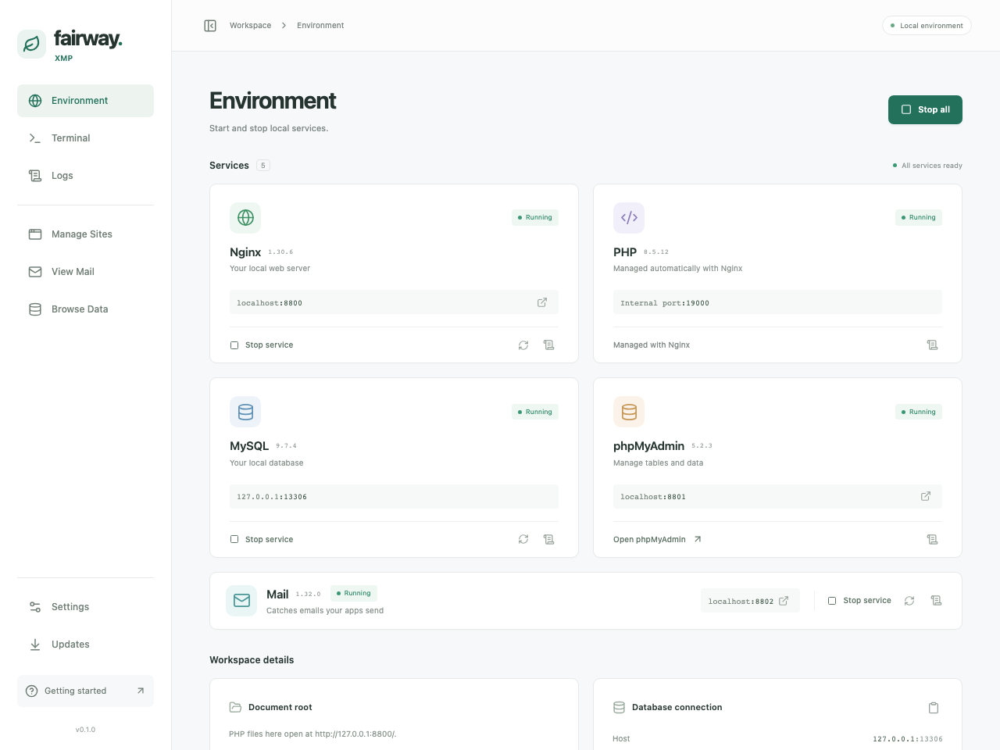

# Fairway XMP

A PHP development environment for Windows, Apple Silicon Macs and Linux x86_64. Run your web server and database from one control panel, write code in your preferred editor, and manage your data with the built-in database browser or phpMyAdmin.

[How-to guides](https://eimg.github.io/fairway-xmp/) · [မြန်မာလမ်းညွှန်](https://eimg.github.io/fairway-xmp/mm/)



*Desktop interface with simulated sample data.*

*Fairway XMP on macOS.*

## Downloads

Latest published release: **[v0.1.1](https://github.com/eimg/fairway-xmp/releases/tag/v0.1.1)**.

| Computer | Requirements | Download |
| --- | --- | --- |
| Windows | Windows 10 22H2 or Windows 11, x64 | [Windows installer](https://github.com/eimg/fairway-xmp/releases/download/v0.1.1/fairway-xmp-0.1.1-windows-x64-setup.exe) |
| Mac | macOS 15 or later, Apple Silicon (M-series) | [Mac installer](https://github.com/eimg/fairway-xmp/releases/download/v0.1.1/fairway-xmp-0.1.1-macos-arm64.pkg) |
| Linux | x86_64, glibc 2.35 or newer | [Terminal installer](https://github.com/eimg/fairway-xmp/releases/download/v0.1.1/fairway-xmp-0.1.1-linux-x86_64.run) · [Archive](https://github.com/eimg/fairway-xmp/releases/download/v0.1.1/fairway-xmp-0.1.1-linux-x86_64.tar.gz) |

See the [release page](https://github.com/eimg/fairway-xmp/releases/tag/v0.1.1) for these downloads and [current limitations](docs/maintenance.md#current-limitations). Download the installer for your computer and follow its prompts. The Mac app and installer are Developer ID signed and notarized by Apple. Windows installers do not yet have Authenticode signatures and may show an unknown-publisher warning; in-app updates use a separate cryptographic signature.

Version 0.1.1 fixes Laravel development servers losing Fairway’s PHP configuration and emitting SNMP warnings. Restart existing Artisan servers after updating. Desktop installations receive the update through their stable or preview feed; Linux users rerun the installer. See the [release notes](docs/release-notes.md).

## Linux terminal edition

Download the Linux `.run` installer or `.tar.gz` archive from the table above. Linux requires x86_64 and glibc 2.35 or newer; Alpine/musl and ARM are not supported. No desktop, root access, distro packages, Docker or systemd service is required.

```sh
sh fairway-xmp-0.1.1-linux-x86_64.run
# Reopen your shell after installation:
fairway                      # terminal dashboard
fairway start                # start all services
fairway status
fairway stop nginx           # also stops its PHP-FPM worker
fairway php --version
fairway composer --version
fairway mysql fairway         # connect with the local teaching account
fairway backup               # requires running MySQL
fairway shutdown             # stop services and the supervisor
```

In the dashboard, use ↑/↓ to select Nginx, MySQL or Mail, `s` to start, `x` to stop, `r` to restart, `a` to start all, `z` to stop all, `l` for logs, `f` for PHP logs, `p` for ports and `b` for a database backup. **`q` closes the dashboard and leaves services running; `Q` shuts everything down.** Run `fairway --help` for CLI commands. phpMyAdmin remains a browser interface at the displayed URL.

The installer defaults to `~/.local/share/fairway-xmp`; use `--prefix /absolute/path` for another dedicated directory. It enables Fairway, PHP and Composer through managed Bash/Zsh profile blocks, exposing bundled fnm when no external fnm is found. `fairway remove-cli` removes that integration. `fairway shell` opens a shell with bundled PHP/Composer and the available fnm without editing profiles. Fish users can invoke the displayed absolute Fairway path or add it to their shell’s PATH themselves.

Alternatively, extract the `.tar.gz` and run `./fairway-xmp/bin/fairway`; `./fairway-xmp/install.sh` installs that extracted bundle. Programs use libraries bundled with their component. Projects remain in `~/fairway/www`; data and backups use `${XDG_DATA_HOME:-~/.local/share}/dev.fairway.environment`.

Re-running the installer backs up an existing student database and stops services before switching versions. `fairway uninstall` removes the installed program and managed shell integration while preserving projects, databases and backups. The release’s Linux source archive includes corresponding runtime sources and distribution patches. This terminal edition uses manual installer updates.

For Node on Linux, use your existing setup or the bundled fnm directly:

```sh
fnm install --lts
# Bash; use --shell zsh for Zsh:
eval "$(fnm env --shell bash)"
fnm use lts-latest
node --version
```

## What’s included

- **PHP 8.5.12** with common extensions for PHP projects and Laravel.
- **Composer 2.10.3** for installing PHP packages.
- **Nginx 1.30.6** for serving your projects.
- **MySQL 9.7.4 LTS** for local databases.
- **phpMyAdmin 5.2.3** for managing tables and data in your browser.
- **Mailpit 1.32.0** for catching the emails your apps send.

The control panel provides service controls, port settings, logs, database backups, and persistent PHP settings for each bundled version.

## PostgreSQL client support

Fairway includes `pdo_pgsql` and `pgsql` in every bundled PHP version (8.2–8.5) on Windows, macOS and Linux. Your PHP applications and Composer projects can connect to a PostgreSQL server you provide, without installing extra PHP drivers. This is additional client support: Fairway does not ship or manage a PostgreSQL server, and the desktop Data browser supports MySQL and SQLite only. Fairway’s environment backup/updater does not back up or upgrade external PostgreSQL databases.

See [PostgreSQL connection examples and requirements](docs/postgres-client-support.md).

Fairway also includes `sockets`, SOAP and LDAP across all bundled PHP versions and platforms, plus `pcntl`/`posix` on macOS and Linux for CLI workers. Redis projects can install Predis through Composer and connect to a server they provide. See [PHP clients and worker support](docs/php-client-support.md) for project setup and platform differences.

## Your first PHP project

1. Open Fairway XMP and click **Start all**. Wait for **All services ready**.
2. Click **Open folder** to open your project folder, `fairway/www` in your home folder.
3. Create a folder named `hello` and add an `index.php` file:

   ```php
   <?php
   echo 'Hello from Fairway XMP!';
   ```

4. Open [http://127.0.0.1:8800/hello/](http://127.0.0.1:8800/hello/) in your browser.

### Sites

You don't need a site to use Fairway: files in `~/fairway/www` always open at `http://127.0.0.1:8800/`. Add a site when an app needs its own address, such as `http://shop.test:8800/`.

Open **Manage Sites** and choose **Add site**, then enter a name, a `.test` domain (suggested from the name), and the **Web root**: the folder Fairway serves. The folder can be anywhere on your computer. For Laravel, choose the application's `public` folder and select **Laravel / front controller** under **App type** so routes such as `/about` reach `index.php`. **Basic PHP / HTML** serves files directly. Only the selected folder is served at the `.test` address. Saving updates Nginx and adds the domain to Fairway's marked section of the system hosts file. On macOS, first-time setup may open **System Settings → General → Login Items & Extensions**: allow Fairway XMP to run in the background. Your site stays saved with **Waiting for macOS approval**, and Fairway finishes address setup automatically after approval, including if you reopen the app. **Open System Settings** returns to the approval page. **Check approval** refreshes the helper registration and retries address setup without reopening Settings; if macOS still reports approval missing, Fairway shows guidance instead of silently leaving the site pending. Windows asks for administrator permission. If an address update is cancelled or fails, the site stays saved and **Set up addresses** retries. Use a site’s actions menu to edit or remove it; removing it keeps its folder and files. If a web root folder is moved or deleted, the site shows **Folder missing** until you restore it or edit its location. Folders inside `~/fairway/www` are also served at `127.0.0.1:8800`, so keep apps with private files (such as `.env`) outside it. The website port is still required in `.test` addresses.

The Sites page shows whether the web server is running and why a site cannot open yet. **Start web server** starts Nginx and PHP without starting MySQL. Each site shows its full URL and web root, with **Open**, **Copy URL**, and an actions menu for opening its folder or a terminal there. When the web root is named `public`, **Terminal in app folder** explicitly opens its parent, where Laravel's `artisan` and `composer.json` normally live. A matching terminal tab is focused; a new tab uses a free slot. If both tabs are occupied, close one before opening another. All sites share the PHP version shown on the page. If saved registrations cannot load, an error and retry action appear instead of an empty list; keep a copy of the saved list before repairing it.

Each site has an optional **HTTPS** switch. The first time you turn it on, Fairway explains that it creates a local certificate authority and asks your operating system to trust it: on macOS it is added to your login keychain (approve with your password), and on Windows to your user certificate store (confirm the security warning). Neither needs an administrator account. HTTPS sites open at `https://domain.test:8443/`; the HTTP address keeps working. In the desktop app, turning off HTTPS for the last site also removes the shared certificate trust in the same action; other HTTPS sites keep using it. If cleanup is cancelled, HTTPS stays off and **Remove certificate trust** lets you retry. Removing the last site that uses HTTPS also removes the certificate trust. Uninstalling Fairway removes its hosts entries and certificate trust. The certificate authority and private key stay in Fairway's application data and must not be shared or copied to another device. For Laravel, set `APP_URL` to the HTTPS address when you want Laravel to generate secure links.

On Linux, use `fairway site add shop ~/code/shop/public --name "My Shop" --index`, `fairway site remove shop`, `fairway site https shop on|off`, and `fairway site hosts` to retry a hosts-file update. `fairway status` lists sites. Hosts-file and certificate changes ask for your sudo password. Browser trust stores can differ on Linux; if a browser still warns, check its certificate settings rather than bypassing the warning.

Closing or minimizing the window keeps Fairway XMP and its services running. Use its macOS menu bar or Windows system tray icon to reopen the panel, start/stop all services or individual Nginx/MySQL/Mail services, open phpMyAdmin, or **Quit**. Nginx automatically manages its PHP worker; PHP CLI works without starting services. Quit gracefully stops all services before exiting.

## PHP and Composer in your terminal

After installation, reopen your terminal and editor so they can find PHP and Composer:

```sh
php --version
composer --version
```

Manage this integration under **Settings → Command-line tools**. You can also use **Open terminal** in the control panel.

An embedded **Terminal** page is available on macOS and Windows. Press **Ctrl+backtick** to open or focus it. PHP and Composer are ready even when persistent command-line integration is disabled. New embedded terminals also import your normal shell’s PATH and exported tool settings on macOS, or the current Windows user/system environment, so existing Node, Python, Git, SDK and user-installed commands remain available. Fairway keeps priority for its PHP and Composer. Use **+** beside the attached tabs and choose a project or registered site folder to open a second terminal while a development server keeps running. The menu shows the actual path to `fairway/www` in your home folder. Both tabs stay open while switching pages or hiding the window; quitting Fairway ends them. Type `exit` to finish: the first terminal opens fresh in its starting folder, while the extra terminal closes its tab. The extra tab also has a close button. Find, text size, clipboard tools, starting-folder details and Restart terminal are in the options or right-click menu. On macOS, the embedded prompt shows `➜` and the current folder name. The terminal height adjusts automatically with the window. Extra space below the panel lets you scroll the terminal higher in the window. The visible **External terminal** button in the header opens a separate system terminal at the active shell’s current path. It uses your normal shell configuration, prompt, history and environment without startup scripts or tool-path injection. Fairway CLI tools are available there according to **Settings → Command-line tools**. The external terminal stays open independently of Fairway.

On macOS, Fairway remembers roughly 1,000 commands privately on your device, separately from your usual shell history. Start a command with a space to omit it, or turn off **Remember commands** in terminal options before creating or restarting a shell. Windows keeps its normal Command Prompt history within each session. macOS and Windows also add a **Data browser** beside phpMyAdmin, with `fairway db` commands for SQL import/export.

Choose **Browse Data → Open SQLite file…** to browse and edit a project's SQLite file directly, without a VS Code extension or running services. SQLite appears in the Data browser, with recent files and backups, rather than as another service. See [Data browser](docs/data-browser.md) for supported operations and limits.

The **Structure** tab supports ordinary/unique index management and foreign-key inspection for MySQL and SQLite, including composite indexes and incoming relationships. Filtering and advanced schema changes remain available through SQL.

Fairway includes PHP 8.2 through 8.5. Switch under **Settings → Service Settings → Advanced settings** after stopping all services. Select the version and click **Save**. The selection controls websites, terminal PHP, and Composer, and is saved for the next launch. On Linux, use `fairway php-version 8.2` through `fairway php-version 8.5` after `fairway stop all`. See the [step by step test guide](docs/testing.md#isolated-development-profiles). PHP 8.5 is the default. A saved PHP 8.0 or 8.1 selection is left in place and blocks startup until you choose PHP 8.2 or later.

Under **Settings → PHP settings**, adjust memory, execution time, upload size, timezone, displayed errors and session upload progress. The active PHP version is shown first; other versions are available under **Choose another PHP version**. Changes survive app updates. Stop Nginx/PHP before saving active settings; **Reset to defaults** restores that version only. See [PHP settings](docs/php-settings.md).

For projects with their own development server, run the usual command, such as Laravel’s `php artisan serve`.

## Node.js on macOS and Windows

See [Node tools](docs/node-tools.md) for storage, activation and troubleshooting across platforms.

The macOS and Windows apps include **fnm**, the upstream Node version manager. The separate **Settings → Node.js** card highlights the version, source manager and executable detected in your login shell (macOS) or current user/system PATH (Windows). **If you already have fnm or a populated fnm store, Fairway shows read-only information and brief CLI guidance; it does not manage those versions or change their default.** Otherwise, **Manage Node.js** opens automatically when no active Node is detected; otherwise it starts collapsed. It offers the latest release in each major from Node 20 onward, including non-LTS majors, and lets you use or uninstall an installed version. Other installations are shown with their manager and path. Node itself is downloaded only when requested.

When Node is missing, **Install & use** installs the selected release and enables it in new terminals. With an existing Node setup, **Install** keeps that setup active; choose the green **Use** button beside an installed version to switch. If command-line tools are enabled, this also configures new Bash/Zsh shells on macOS or Command Prompt and PowerShell sessions on Windows. Existing terminals and development servers keep their version; reopen them to pick up changes. Other Node installations are kept, and you can switch back with **Use existing Node setup**. There is no automatic project switching. **Uninstall** removes only the selected fnm version and its global npm packages. Uninstalling the active default first turns off Fairway’s activation; other managers’ installations are kept.

Fairway keeps an existing fnm ahead of its bundled executable. For a new setup, the normal CLI is available directly after enabling command-line tools: `fnm install --lts`, `fnm list`, `fnm use VERSION`, and `fnm default VERSION`. Manual Zsh activation is `eval "$(fnm env --shell zsh)"` (use `--shell bash` for Bash). Fairway adds no command wrapper. Versions live in fnm's user storage and survive app updates and removal. On Windows, Fairway copies the unchanged `fnm.exe` into its CLI tools folder when no external fnm is detected. Opting into Node activation adds a removable user Command Prompt AutoRun entry and managed blocks in the normal Windows PowerShell 5 and PowerShell 7 profiles. Existing startup commands and profile contents are preserved. PowerShell uses your existing script execution policy; sessions started with `-NoProfile` or Command Prompt `/D` skip these hooks. For Fairway-managed versions, the embedded terminal initializes fnm independently. Manual PowerShell activation is `fnm env --shell powershell | Out-String | Invoke-Expression`. Linux also includes the unchanged fnm CLI; initialize it in your preferred shell yourself, with no Fairway Node wrapper or automatic project switching.

## Your database

Click **Open phpMyAdmin**, or visit [http://127.0.0.1:8801/](http://127.0.0.1:8801/). Sign in with username **fairway** and password **fairway**.

Use these connection settings in your PHP projects:

| Setting | Value |
| --- | --- |
| Host | `127.0.0.1` |
| Port | `13306` |
| Database | `fairway` |
| Username | `fairway` |
| Password | `fairway` |

You can create additional databases in phpMyAdmin. Services accept connections from your computer only.

To save a SQL backup, click **Back up databases**. Find saved backups under **Settings → Open backups**, and import them through phpMyAdmin when needed.

For complete database recovery, including routines and triggers, follow the [backup and restore guide](docs/backup-and-restore.md). Support reports are available under **Settings → Help and diagnostics** or with `fairway diagnostics` on Linux.

## Test emails

Fairway XMP catches every email your PHP apps send, so nothing reaches real inboxes. **Start all** also starts Mail. Open **View Mail** in the sidebar to read, search, and delete caught emails, and to save attachments. Supported remote images load automatically in the preview. If an image fails to load, use **Retry image** on its placeholder. Use **Open in browser** for Mailpit’s full inbox at [http://127.0.0.1:8802/](http://127.0.0.1:8802/).

PHP’s `mail()` works without any setup. For Laravel and other frameworks that send through SMTP, copy the settings from the Mail page:

```
MAIL_MAILER=smtp
MAIL_HOST=127.0.0.1
MAIL_PORT=11025
```

## Ports

| Service | Default port |
| --- | --- |
| Website | `8800` |
| phpMyAdmin | `8801` |
| MySQL | `13306` |
| PHP’s connection to Nginx | `19000` |
| Mail inbox | `8802` |
| Mail SMTP | `11025` |

If a port is already in use, Fairway XMP shows the conflict. Stop all services, change the port in **Settings**, and save. If you change the MySQL port, use the new port in your project’s database settings.

## Updates and removal

macOS and Windows users can choose **Updates → Check for updates → Install update**. Fairway verifies the signed download before backing up databases, stopping services, and installing the update.

Projects, databases, settings and saved sites are kept during updates. For a manual installation, back up databases, stop services and quit Fairway first. If an older installation has no Updates page, install the current download once to enable subsequent in-app updates.

Linux updates remain manual: download and run the newer `.run` installer over the existing installation, using the same `--prefix` if you chose a custom directory. It backs up databases and stops services before switching versions; projects and data are preserved.

To uninstall:

- **Windows:** open **Settings → Apps**, select **Fairway XMP**, and choose **Uninstall**.
- **Mac:** quit Fairway XMP, then open **Applications** in Finder. Right-click **Fairway XMP → Show Package Contents**, open **Contents → Resources**, and double-click **Uninstall Fairway XMP.command**.
- **Linux:** run `fairway uninstall`.

The uninstaller removes the app and its command-line integration. Your projects and database data are kept unless you choose to delete them.

## Help and license

For task instructions and troubleshooting, see the [English how-to guides](https://eimg.github.io/fairway-xmp/)
or [မြန်မာလမ်းညွှန်](https://eimg.github.io/fairway-xmp/mm/).
See the [technical documentation index](docs/README.md) for development, testing, releases and maintenance.

For problems or suggestions, [open an issue](https://github.com/eimg/fairway-xmp/issues). Include your operating system, what you tried, and any error shown in Fairway XMP.

Fairway XMP’s application code uses the [MIT license](LICENSE). Included tools have [their own licenses](THIRD_PARTY_NOTICES.md). Release checksums and bundled-tool sources are available on the [release page](https://github.com/eimg/fairway-xmp/releases/tag/v0.1.1). For contributing to the app, see [Contributing](CONTRIBUTING.md).
